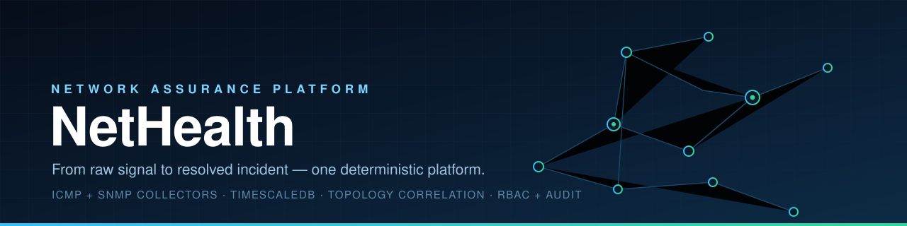
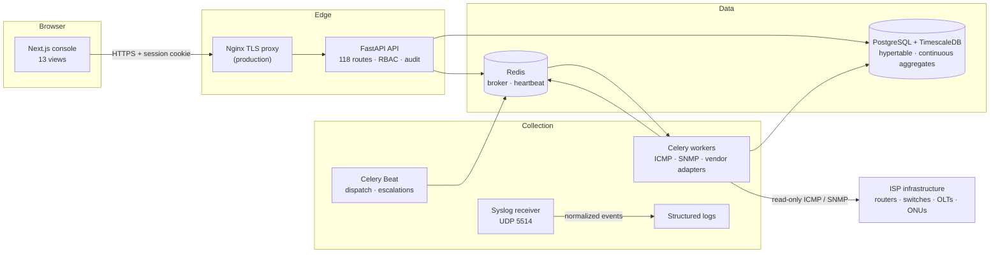

<div align="center">
  
</div>

<div align="center">

**Network monitoring, assurance, outage correlation, and incident management for ISPs.**

[](https://github.com/SyedShah29/Nethealth/actions/workflows/ci.yml)
[](LICENSE)
[](https://www.python.org/)
[](https://fastapi.tiangolo.com/)
[](https://nextjs.org/)
[](https://www.timescale.com/)

</div>

---

## What is NetHealth?

NetHealth is a self-hosted network assurance platform built for the way ISPs
actually operate. It keeps a live model of the access network — sites, routers,
switches, OLTs, PONs, ONUs, subscribers — and continuously reads device health
over ICMP and SNMP. Every observation lands in a TimescaleDB hypertable, where
it powers dashboards, capacity trends, optical diagnostics, and dependency-aware
outage analysis.

When something breaks, NetHealth does not stop at a red status. It resolves the
affected subscribers into a topology graph, finds the lowest common failing
ancestor, classifies the fault, assigns an evidence-derived confidence level,
and opens exactly one incident with the affected scope, the evidence, and the
checks an engineer should run. From there, incidents move through a real
lifecycle: acknowledgement, investigation, escalation, field dispatch, repair,
and closure — all audited.

Everything is deterministic. Every score, classification, threshold, and
projection is a rule you can read in the source, with the evidence retained in
the database. No LLM, no opaque model, no probabilistic guesswork.

---

## Highlights

**See the whole access network**
- Site → device → interface inventory with filtering, search, and grouping.
- OLT → frame/slot/port PON → ONU hierarchy with composite integrity checks.
- Pseudonymous subscriber records, session history, and IP/MAC normalization.
- Optical thresholds matched by vendor, technology, and device model.

**Collect continuously, safely**
- Read-only ICMP and SNMP collection from isolated Celery workers.
- SNMPv3 (MD5/SHA auth, DES/AES privacy) with SNMPv2c fallback.
- Cisco, Huawei, MikroTik, ZTE, and generic SNMP adapters.
- Per-assignment intervals, failure thresholds, DEGRADED/UNREACHABLE states,
  and persistent collector status.
- Credentials stay out of task payloads and API responses.

**Turn signal into understanding**
- TimescaleDB hypertable with 5-minute, hourly, and daily continuous aggregates.
- Counter-derived interface rates and utilization.
- Directed topology graph with downstream impact, common ancestors, and
  cycle protection.
- Correlation by lowest common failing ancestor with LOW/MEDIUM/HIGH/CONFIRMED
  confidence and shared-dependency evidence.
- Deterministic root-cause classification for core congestion, PON, OLT, link
  congestion, and subscriber optical faults.
- Six-component subscriber health scoring and six anomaly methods (z-score,
  EWMA, rate of change, seasonal, baseline, rolling).
- Customer 360 diagnostics that compose identity, session, fiber, performance,
  stability, incident, and health into one view.

**Operate the response**
- Incident lifecycle with de-duplication, timeline events, evidence attachment,
  and dependency-aware suppression.
- Notification routing with per-incident/per-channel delivery de-duplication and
  a pluggable delivery adapter layer.
- Escalation policies with ordered delay steps.
- Field-technician tasks with ordered transitions, notes, and bounded photo
  uploads.
- Maintenance windows that label expected faults and suppress downstream noise.
- Capacity thresholds, sustained-load assessment, and OLS trend projections that
  always disclose their assumptions.
- Operational analytics, six CSV report types, and permission-filtered search.

**Build on a hardened foundation**
- Argon2id passwords, opaque server-side sessions, lockout, and revocation.
- 26 granular permission codes across five roles, enforced per endpoint.
- Append-only audit log for authentication, configuration, and incident actions.
- Separate migration, application, and read-only backup database roles.
- Non-root containers, dropped capabilities, read-only root filesystems, and
  loopback-only host ports.
- Encrypted, restorable PostgreSQL backups and a guarded restore procedure.
- Optional Nginx TLS reverse proxy with rate limiting and security headers.

---

## Architecture



The API, scheduler, database, and cache share an internal network. Only the
collection workers join the network that can reach management addresses, and
only the frontend, API, and syslog receiver publish host ports — all bound to
`127.0.0.1`.

---

## Tech stack

| Layer | Technology |
| --- | --- |
| API | Python 3.12, FastAPI, Pydantic v2, Uvicorn |
| Data | SQLAlchemy 2 (async), asyncpg, Alembic, PostgreSQL 16, TimescaleDB 2.19 |
| Queue | Celery 5, Redis 7 |
| Collection | pysnmp 7, platform ICMP, custom syslog receiver |
| Security | Argon2id, opaque hashed sessions, RBAC, append-only audit |
| Frontend | Next.js 16 (App Router), React 19, TypeScript 5.9 |
| Testing | pytest + pytest-asyncio, Vitest + Testing Library |
| Delivery | Docker Compose, multi-stage images, Nginx TLS proxy |
| Quality | Ruff, strict mypy, ESLint, TypeScript, GitHub Actions |

---

## Quick start

**Requirements:** Docker Desktop with Compose. Node 22 and Python 3.12 are only
needed for host-side checks.

```bash
git clone https://github.com/SyedShah29/Nethealth.git
cd Nethealth

# 1. Configure — replace every CHANGE_ME with a unique random value
cp .env.example .env

# 2. Start the stack
docker compose up --build
```

| Service | URL |
| --- | --- |
| Console | http://127.0.0.1:3000 |
| API | http://127.0.0.1:8000/api/v1/health |
| API docs (non-production) | http://127.0.0.1:8000/api/docs |

PostgreSQL and Redis are internal-only. Use `docker compose exec postgres psql`
for database administration; neither service publishes a host port.

**Create the first administrator** (password is prompted, never placed in shell
history):

```bash
docker compose exec backend python -m app.cli.create_admin \
  --name "NetHealth Administrator" --email "admin@example.com"
```

The bootstrap command refuses to run once an active administrator exists.
Further users are created through the authenticated `/api/users` API.

**Add a device:** create a collector profile, supply its SNMP configuration in
`COLLECTOR_PROFILES_JSON` for the worker, create a collector assignment, and
enable monitoring on the device. The scheduler takes it from there.

**Production:** overlay the hardened configuration with a TLS certificate and
key:

```bash
docker compose -f docker-compose.yml -f docker-compose.production.yml up -d
```

This removes direct application ports and places Nginx on
`127.0.0.1:${TLS_PORT:-8443}`.

---

## API at a glance

Every route is available at both `/api/...` and `/api/v1/...`. All non-public
routes require the session cookie; operational routes also require a named
permission.

```text
POST   /api/auth/login                  session cookie
GET    /api/health                      public liveness
GET    /api/health/database             public dependency check
GET    /api/devices                     inventory:read
POST   /api/devices                     devices:manage
GET    /api/metrics                     metrics:read
GET    /api/subscribers/{id}/diagnostics diagnostics:read
POST   /api/correlations/evaluate       incidents:manage
POST   /api/rules/{id}/evaluate         rules:manage
GET    /api/incidents                   incidents:read
PATCH  /api/incidents/{id}              incidents:manage
GET    /api/dashboard                   dashboards:read
GET    /api/system/platform-health      dashboards:read
```

The full surface — 118 routes across authentication, inventory, metrics,
subscribers, fiber, topology, rules, analysis, operations, workflows, and
platform health — is documented in [`docs/API.md`](docs/API.md). Errors share a
single envelope:

```json
{"error": {"code": "PERMISSION_DENIED", "message": "…", "request_id": "…"}}
```

---

## Security model

- **Authentication:** Argon2id hashing, dummy-hash timing equalization, per-user
  lockout, opaque 48-byte session tokens, SHA-256 token storage, explicit expiry
  and revocation, `HttpOnly` + `SameSite=strict` cookies.
- **Authorization:** five roles and 26 permission codes, checked by dependency
  on every protected route; technician task scoping; permission-filtered search.
- **Auditability:** append-only records for login, logout, user and role
  changes, configuration changes, threshold changes, and incident actions.
- **Infrastructure boundary:** only collector services reach management
  addresses; the browser and API never do. No write path to network devices.
- **Data boundary:** pseudonymous subscriber identifiers; no CNIC, payment, or
  browsing data; secrets held in the environment and redacted from responses.
- **Deployment:** least-privilege database roles, SCRAM host auth, non-root
  containers, no Docker socket, no privileged mode, no host networking,
  loopback-only publications.
- **Recovery:** AES-256 encrypted custom-format dumps, encrypted configuration
  archives, and a restore job that refuses the source database and verifies into
  a disposable database.

See [`docs/SECURITY.md`](docs/SECURITY.md) and [`SECURITY.md`](SECURITY.md).

---

## Repository layout

```text
backend/
  app/
    api/            routes, dependencies, permission enforcement
    core/           configuration, logging, middleware, errors
    collectors/     ICMP, SNMP, vendor adapters, syslog, runtime
    models/         39 mapped models across 40 tables
    schemas/        request and response contracts
    services/       analysis, operations, workflows, reporting
    repositories/   query and persistence layer
    db/             async engine and session factory
  migrations/       19 Alembic revisions
  tests/            pytest suites
frontend/
  src/app/          13 views (App Router)
  src/lib/api/      typed fetch client
  src/ui/           shared components
simulator/          deterministic synthetic network generator
scripts/            acceptance-evidence validator, scale harness
docker/postgres/    role provisioning, encrypted backup and restore
deploy/nginx/       production TLS reverse proxy
docs/               architecture, API, data model, security, operations
```

---

## Documentation

- [Architecture](docs/ARCHITECTURE.md) — boundaries, layers, and phase design
- [API](docs/API.md) — endpoints, payloads, and permissions
- [Data model](docs/DATA_MODEL.md) — tables, relationships, and retention
- [Security](docs/SECURITY.md) — threat model, roles, and secret handling
- [Deployment](docs/DEPLOYMENT.md) — production rollout and disaster recovery
- [Testing](docs/TESTING.md) — required coverage and verification commands
- [Performance](docs/PERFORMANCE.md) — synthetic scale and failure scenarios
- [Operational rollout](docs/OPERATIONAL_ROLLOUT.md) — pilot-to-network gates

---

## Verification

```bash
# Backend
cd backend
python -m pytest
python -m ruff check .
python -m mypy app
alembic upgrade head --sql

# Frontend
cd frontend
npm test
npm run lint
npm run typecheck
npm run build
```

The same checks run in GitHub Actions on every push and pull request.

---

## License

Released under the [MIT License](LICENSE).
